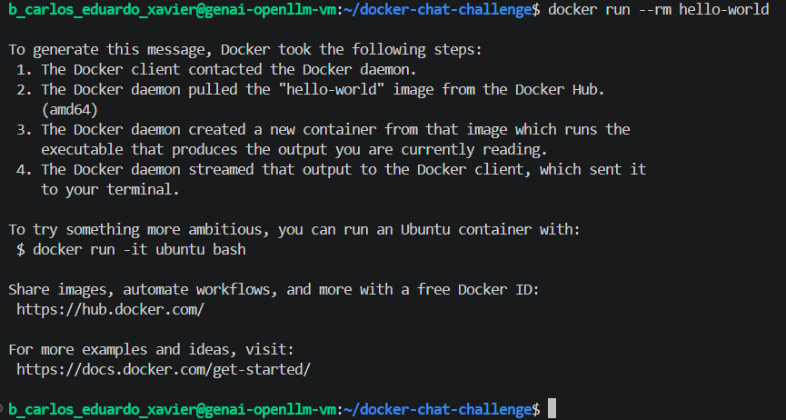
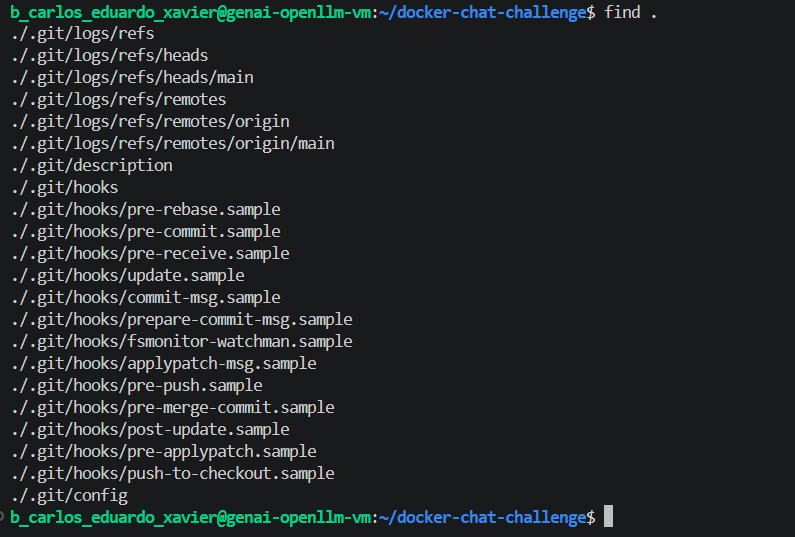
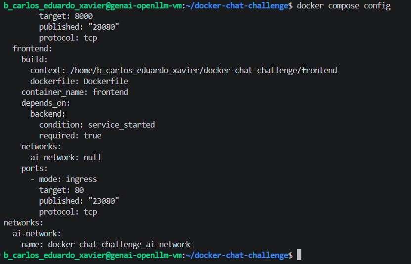
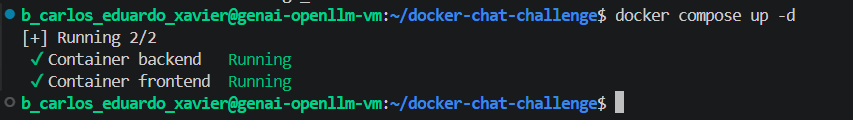
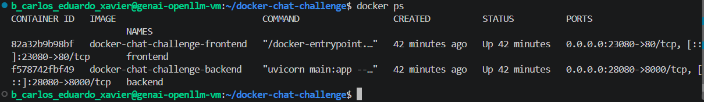
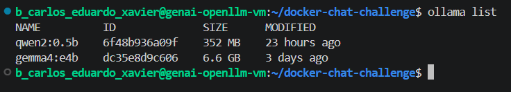
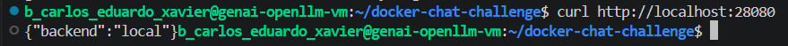
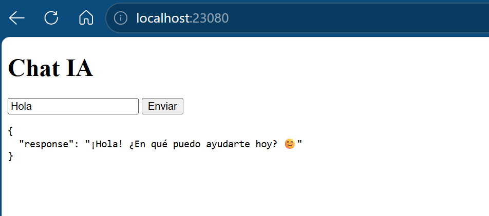

# Docker Chat Challenge

**Autor: Carlos Eduardo Xavier**

## Descripción

Práctica de Docker orientada a contenerizar una aplicación de chat basada en IA.

La solución implementada incluye:

- Backend desarrollado con FastAPI.
- Frontend web servido mediante Nginx.
- Configuración mediante Docker Compose.
- Variables de entorno mediante archivo `.env`.
- Integración con Ollama y el modelo `gemma4:e4b`.
- Comunicación entre servicios mediante red Docker.

---

## Estructura del proyecto

```text
docker-chat-challenge/
│
├── backend/
│   ├── main.py
│   ├── requirements.txt
│   └── Dockerfile
│
├── frontend/
│   ├── index.html
│   └── Dockerfile
│
├── docker-compose.yml
├── .env
└── README.md
```

---

## Ejecución

Levantar los servicios:

```bash
docker compose up -d
```

Comprobar contenedores:

```bash
docker ps
```

Parar servicios:

```bash
docker compose down
```

---

## Variables de entorno

Archivo `.env`

```env
BACKEND_MODE=local
OLLAMA_URL=http://host.docker.internal:11434
REMOTE_API_URL=http://IP_VM_REMOTA:8000
```

---

## Servicios desplegados

### Backend (FastAPI)

Puerto publicado:

```text
28080 -> 8000
```

Comprobación:

```bash
curl http://localhost:28080
```

Respuesta:

```json
{"backend":"local"}
```

---

### Frontend (Nginx)

Puerto publicado:

```text
23080 -> 80
```

Acceso:

```text
http://localhost:23080
```

---

## Modelo IA utilizado

Comprobación:

```bash
ollama list
```

Modelos disponibles:

```text
qwen2:0.5b
gemma4:e4b
```

---

# Evidencias de funcionamiento

## 1. Verificación de Docker

**Comando ejecutado**

```bash
docker run --rm hello-world
```

**Resultado**

Docker instalado y funcionando correctamente.



---

## 2. Estructura del proyecto

**Comando ejecutado**

```bash
find .
```

**Resultado**

```text
./backend
./backend/main.py
./backend/requirements.txt
./backend/Dockerfile
./.env
./frontend
./frontend/index.html
./frontend/Dockerfile
./docker-compose.yml
```



---

## 3. Validación de Docker Compose

**Comando ejecutado**

```bash
docker compose config
```

**Resultado**

Configuración validada correctamente.



---

## 4. Despliegue del stack

**Comando ejecutado**

```bash
docker compose up -d
```

**Resultado**

Servicios iniciados correctamente.



---

## 5. Contenedores en ejecución

**Comando ejecutado**

```bash
docker ps
```

**Resultado**

```text
backend    Up
frontend   Up
```



---

## 6. Modelos disponibles en Ollama

**Comando ejecutado**

```bash
ollama list
```

**Resultado**

```text
qwen2:0.5b
gemma4:e4b
```



---

## 7. Verificación del Backend

**Comando ejecutado**

```bash
curl http://localhost:28080
```

**Resultado**

```json
{"backend":"local"}
```



---

## 8. Verificación del Frontend

**Acceso**

```text
http://localhost:23080
```

**Resultado**

La aplicación web carga correctamente mostrando la interfaz de Chat IA.



---

# Conclusiones

Se ha desarrollado y desplegado correctamente una aplicación contenerizada utilizando Docker Compose.

La solución incluye:

- Backend desarrollado con FastAPI.
- Frontend desplegado mediante Nginx.
- Configuración mediante variables de entorno.
- Red Docker para comunicación entre servicios.
- Integración con Ollama y el modelo Gemma 4 E4B.
- Despliegue automatizado mediante Docker Compose.

Las pruebas realizadas verifican que todos los componentes funcionan correctamente.